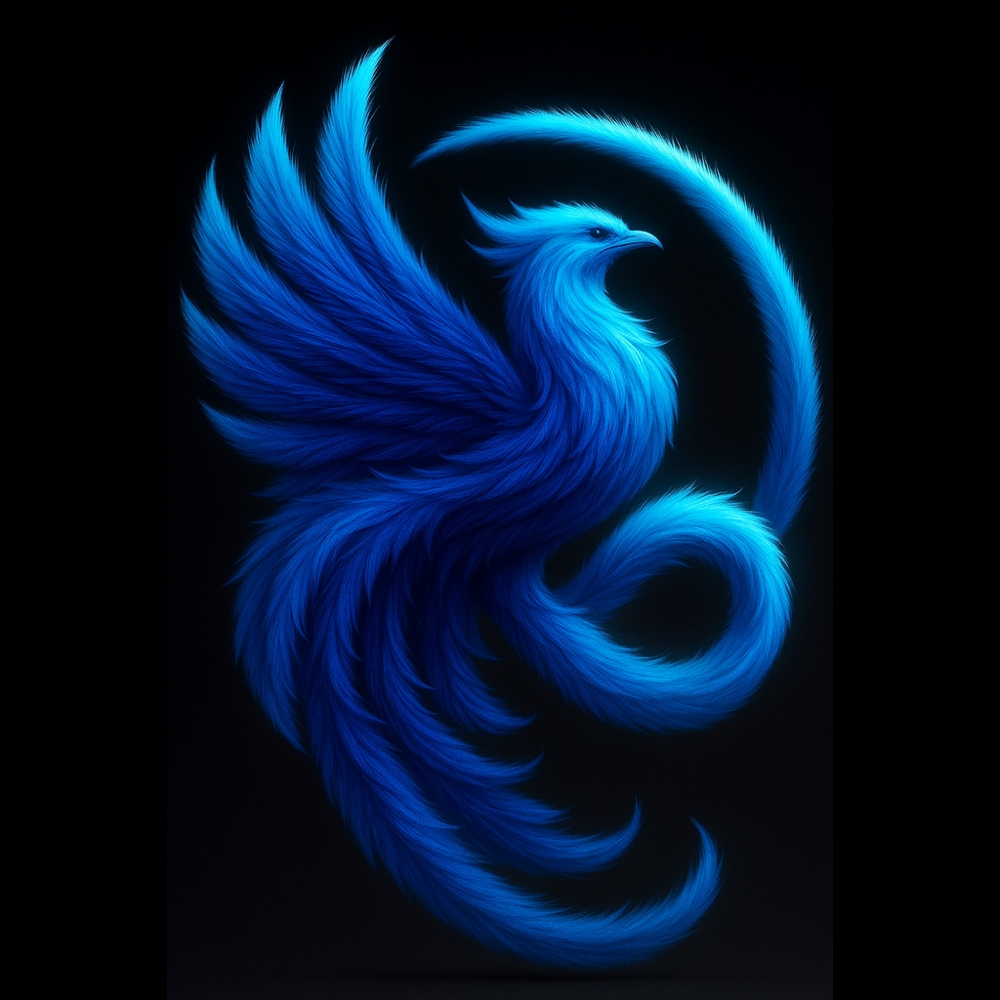

# Luphonix — Smart Daily Reminder & Personal Assistant for iOS

[](https://swift.org)
[](https://developer.apple.com/ios/)
[](https://hono.dev)
[](https://turso.tech)
[-brightgreen.svg)]()

<p align="center">
  
  <br />
  <b>Luphonix</b>
</p>

**Luphonix** is a modern, production-ready iOS application and cloud ecosystem designed to help users manage daily routines, schedule reminders, track water intake, and organize tasks seamlessly using both **Apple's built-in Siri voice commands** and a refined native **SwiftUI interface**.

The system pairs a native SwiftUI client with a secure, lightweight **TypeScript (Hono) backend** connected to **Turso (libSQL)** for edge-replicated, cloud-synchronized persistence.

---

## 📱 Features Overview

### 1. 🔔 Smart Daily Reminders
- Schedule one-time, daily, weekly, or weekday recurring reminders.
- Uses native `UNUserNotificationCenter` for high-reliability local delivery without continuous background battery drain.
- Actionable notification categories: **Mark as Done** and **Snooze (15m)** directly from the lock screen.
- Categorize by *Personal, Work, Study, Health, Other*.
- Automatic recurrence advance: when a recurring reminder is completed, its next occurrence is calculated and rescheduled automatically.

### 2. 🎙️ Deep Siri Voice Assistant Integration (App Intents)
- Built using Apple's modern **App Intents** framework (iOS 16, 17, 18+), discoverable in both Siri and the Apple Shortcuts app.
- Natural voice interactions with Apple's built-in Siri:
  - *"Siri, add a reminder in Luphonix to study at 8 PM."*
  - *"Siri, remind me to drink water every hour in Luphonix."*
  - *"Siri, add a task to complete my project tomorrow in Luphonix."*
  - *"Siri, what are my tasks for today in Luphonix?"*
  - *"Siri, mark my study task as completed in Luphonix."*
  - *"Siri, remind me in Luphonix to take my medicine."*
  - *"Siri, remind me in Luphonix to call my friend."*
  - *"Siri, log 250 ml of water in Luphonix."*
  - *"Siri, how much water have I drunk today in Luphonix?"*
- **App Group shared cache** (`group.com.luphonix.app`) provides instant voice command response times even when completely offline.

### 3. 💧 Drink Water Reminder & Hydration Tracker
- Daily customizable water intake goal (e.g. 2,000 ml).
- Configurable interval reminders (30, 60, 90, 120 minutes) constrained between user's **waking time** and **sleeping time**.
- Automatic quiet-hours protection.
- Quick-add log buttons: **150 ml (Glass)**, **250 ml (Cup)**, **350 ml (Mug)**, **500 ml (Bottle)**, plus custom volume entry.
- Animated progress ring and 7-day hydration historical bar chart.
- One-tap Pause / Resume toggle for reminders.

### 4. 📋 Manual Task Management
- Full task lifecycle: create, edit, search, prioritize (*Low, Medium, High*), and complete.
- Categorization and subtask checklists.
- Quick filter tabs: **Today, Upcoming, Overdue, Completed**.
- Multi-field sorting by Due Date, Priority, Creation Date, or Title.
- One-tap conversion of tasks into scheduled reminders.

### 5. 🛡️ Secure Turso (libSQL) Cloud Backend
- High-performance, edge-replicated database backed by Turso libSQL.
- Security-first architecture: `iOS App -> Secure Hono API -> Turso Database`. The client app **never** handles or stores database authentication credentials.
- JWT Bearer token authentication with password hashing (bcrypt).
- Bi-directional delta synchronization (`/api/sync`) with timestamp cutoff and conflict resolution.
- Comprehensive GDPR/privacy compliance with data export (`/api/auth/export`) and full account deletion (`/api/auth/delete`).

---

## 🏛️ System Architecture

```text
┌─────────────────────────────────────────────────────────────┐
│                       Apple Ecosystem                       │
│                                                             │
│   ┌──────────────────────┐       ┌──────────────────────┐  │
│   │  Built-in Apple Siri │       │   Luphonix SwiftUI   │  │
│   │     (App Intents)    │       │     Tabs & Views     │  │
│   └──────────┬───────────┘       └──────────┬───────────┘  │
│              │                              │               │
│              └──────────────┬───────────────┘               │
│                             │                               │
│              ┌──────────────▼──────────────┐                │
│              │  App Group Shared Cache     │                │
│              │  (group.com.luphonix.app)   │                │
│              └──────────────┬──────────────┘                │
│                             │                               │
│              ┌──────────────▼──────────────┐                │
│              │  APIClient (Async / Await)  │                │
│              └──────────────┬──────────────┘                │
└─────────────────────────────┼───────────────────────────────┘
                              │ HTTPS / JWT
┌─────────────────────────────▼───────────────────────────────┐
│               Luphonix Backend (TypeScript + Hono)          │
│                                                             │
│   ┌──────────────┐   ┌──────────────┐   ┌──────────────┐    │
│   │ Auth Routes  │   │ Tasks Routes │   │ Reminders    │    │
│   └──────────────┘   └──────────────┘   └──────────────┘    │
│   ┌──────────────┐   ┌──────────────┐   ┌──────────────┐    │
│   │ Hydration    │   │ Preferences  │   │ Delta Sync   │    │
│   └──────────────┘   └──────────────┘   └──────────────┘    │
└─────────────────────────────┬───────────────────────────────┘
                              │ libSQL Protocol
┌─────────────────────────────▼───────────────────────────────┐
│                     Turso Database                          │
│                                                             │
│   [users]   [tasks]   [reminders]   [hydration_logs]        │
│   [user_preferences]                                        │
└─────────────────────────────────────────────────────────────┘
```

---

## 🚀 Quick Start Guide

### 1. Running the Backend API
Prerequisites: Node.js 18+

```bash
cd backend

# Install dependencies (Hono, @libsql/client, Zod, bcrypt, JWT)
npm install

# Run database schema migrations
npm run migrate

# Run the automated backend test suite (13 passing tests)
npm test

# Start the local development server
npm run dev
# Server boots at http://localhost:3000
```

### 2. Opening and Running the iOS App
Prerequisites: macOS with Xcode 15+ (or open in SwiftPM)

1. Open `SiriLife.xcodeproj` in Xcode.
2. Select your iPhone (e.g. iPhone 16 Pro) or simulator.
3. Build and Run (`⌘R`).
4. Tap **"Continue as Guest (Instant Preview)"** or register a new cloud account.
5. Grant Notification permissions when prompted.

---

## 🧪 Testing Coverage

### Backend Test Suite (Node.js & Turso libSQL)
All 13 integration tests execute against the libSQL database:
- ✅ Health endpoint check
- ✅ User registration with password hashing & JWT generation
- ✅ User login and token validation
- ✅ Task creation with priority, due date, and category
- ✅ Task filtering by status (*today, overdue, upcoming*)
- ✅ Task completion toggle
- ✅ Recurring reminder scheduling
- ✅ Reminder snooze functionality
- ✅ Hydration intake logging
- ✅ Daily hydration goal and remaining calculation
- ✅ User preferences update (water goal, intervals, quiet hours)
- ✅ User data export (GDPR compliance)
- ✅ Delta cloud synchronization (`/api/sync`)

### iOS Unit Test Suite (XCTest)
- ✅ `TaskTests.swift`: Overdue date arithmetic, subtask state transitions, priority sort orders.
- ✅ `ReminderTests.swift`: Recurrence rule calculations (*daily, weekly, weekdays*), snooze offset math.
- ✅ `HydrationTests.swift`: Progress percentage clamping, active hour time parsers.
- ✅ `APIClientTests.swift`: ISO8601 date serialization, Codable mapping.
